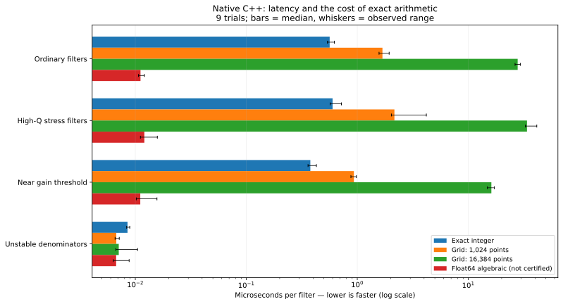
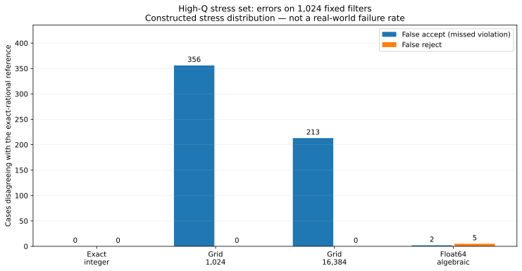
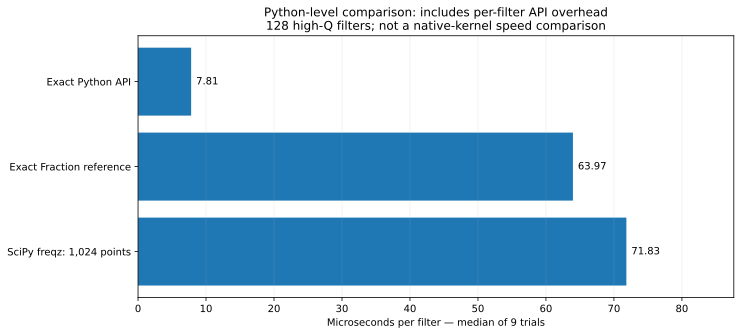
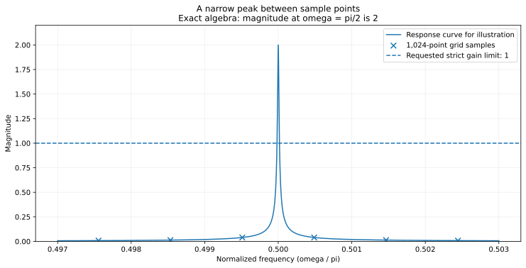

# 基准测试方法、数据解读与复现

[English](../en/BENCHMARKS.md) · [한국어](../ko/BENCHMARKS.md) · [简体中文](../zh-CN/BENCHMARKS.md) · [日本語](../ja/BENCHMARKS.md)

[Dexted DSP](../../README.zh-CN.md)

## 1. 问题和结果来源

本实验研究：**各实现检查严格 biquad 增益条件需要多久，以及哪些数值方法会在构造输入上偏离精确有理数判定？** 不测试语音增强、视频修复、FFT 加速或 OpenAI 的 Crouzeix 定理。

表格来自 [benchmark.json](../../benchmarks/results/benchmark.json)。这是原 v0.1.0 测量；[environment.json](../../benchmarks/results/environment.json) 的记录时间为 `2026-10-07T14:04:45.884162+00:00`。文档修订审计存档并运行**另外的**小规模冒烟测试，没有用更快的运行替换原始结果。

## 2. 判定内容和比较方法

被测条件是实首一分母 `z²+a1 z+a2` 严格 Schur 稳定，且 `sup |H(exp(i omega))| < gamma`。阈值为 binary64 `gamma=0.9999`。系数先保存为 binary32，再无损提升读取；等号不通过。

| 方法键 | 实现 | 含义 |
|---|---|---|
| `integer` | 发布的 C++ 头文件：整数解码、Jury 判定、精确二次式符号 | 对给定值和模型进行精确判定 |
| `grid1024` | 自行实现的含端点 `[0,pi]` 均匀网格、复数 double、缓存三角函数 | 仅采样，不是连续区间证明 |
| `grid16384` | 相同实现，16,384 个点 | 更密的网格仍然不是证明 |
| `float64_algebraic` | 在 binary64 中计算相同 Jury/二次式，不使用区间算术 | 强且快速的基线，但相消可能改变符号 |
| `python_integer_api` | 真实 Python 公共 API | 包括证书构造和逐次调用成本 |
| `fraction_reference` | `reference.py` 的独立有理数表达 | 参考判定，并非外部验证 |
| `scipy_freqz1024` | 实际 SciPy `signal.freqz`，附加分母检查及阈值比较 | Python 层采样基线，不是原生内核 |

SciPy 将 `freqz` 定义为响应求值 [SCIPY-FREQZ]。原生网格没有复制 SciPy 或 ADAC 的源码，也没有进行 ADAC 端到端、SLICOT、MATLAB 或全部 H-infinity 算法的对比。

## 3. 输入生成、精度和参考判定

NumPy 种子为 **20261007**。[run.py](../../benchmarks/run.py) 中的 `generate()` 每组生成 1,024 行，再将整组系数转换为连续 binary32 数组。均为人工合成数据，不代表录音、产品使用频率或真实故障率。

| 数据组 | 转换为 binary32 之前的生成过程 |
|---|---|
| 普通 | 极点半径在 `[0.02,0.995)` 均匀分布，角度在 `[0.02,pi-0.02)`；三个分子系数为均值 0、标准差 0.25 的正态分布 |
| 高 Q | `scipy.signal.iirpeak(f,Q)`；`f` 在 `[0.005,0.995)`，`Q=10^U`，`U` 在 `[2,6)`；分子再乘 `10^V`，`V` 在 `[-0.4,0.4)` |
| 阈值附近 | 将一阶节嵌入 biquad；极点 `r` 在 `[0.02,0.99)`，峰值 `1+U`，`U` 在 `[-0.0005,0.0005)` |
| 不稳定分母 | 共轭极点半径在 `[1.00001,1.3)`，角度范围同上；分子正态标准差为 0.1 |

| 数据组 | 滤波器数 | 精确判定通过 | 精确判定不通过 |
| --- | --- | --- | --- |
| 普通滤波器 | 1024 | 611 | 413 |
| 高 Q 值压力测试 | 1024 | 539 | 485 |
| 接近增益阈值 | 1024 | 431 | 593 |
| 不稳定分母 | 1024 | 0 | 1024 |

参考答案由 `Fraction` 计算，而不是更密的网格。计时前，Python 整数与原生整数结果必须一致。另有种子 **20261107**、阈值 1.0 下的 **2,048 行随机 binary32 位模式**测试；非有限值等无效输入应返回错误。这是移植和解码检查，不是第五组速度数据。

Python 比较复用高 Q 数据的**前 128 行**，不是独立保留测试集。固定种子用于复现，不声称实验预注册或统计代表性。

## 4. 计时包含和排除什么？

所有原生方法在同一编译单元中使用 GCC 14.2.0、`-O3 -std=c++20 -shared -fPIC -ffp-contract=off`，不使用 fast-math。9 轮中，每轮用种子 **932851** 对方法顺序洗牌。测量前先调用一次当前方法，确保对应网格缓存已预热，再计时 4 个完整批次。

$$t_{\text{filter},\mu s}=\frac{t_{\text{elapsed},ns}}{1024\cdot4\cdot1000}.$$

计时器是 `time.perf_counter_ns`。原生时间包含分摊的 ctypes 调用成本、输出写入、输入有效性与分母检查；不包含输入生成、参考答案、正确性对照和网格缓存构造。网格发现违规可提前退出，并比较模平方，避免开方或除法。

Python 使用单独的逐滤波器循环、缓存的 omega 向量和 4 个模型预热。滤波器对象在**计时前**构造；函数调用、精确 API 的证书对象构造、循环及结果列表成本包含在内。SciPy 计算完整响应向量，与原生提前退出内核并非相同工作量，必须分别解读。

主机报告 AMD EPYC 9V74、Linux x86-64、5 个可见逻辑 CPU、Python 3.13.5、NumPy 2.3.5、SciPy 1.17.0。`OMP_NUM_THREADS=1`、`OPENBLAS_NUM_THREADS=1`，MKL 未设置。**没有 CPU 绑定、固定频率或独占机器。** 结果是该共享环境的描述性测量，不是跨硬件保证。

## 5. 原生结果和统计定义

单位为 **µs/滤波器**。柱为中位数，误差线为 9 次观测的最小/最大值，**不是置信区间**。

| 数据组 | 精确整数判定 | 1,024 点网格 | 16,384 点网格 | Float64 代数判定 | 网格 1,024 / 整数¹ |
| --- | --- | --- | --- | --- | --- |
| 普通滤波器 | 0.564106 | 1.686392 | 27.877729 | 0.011137 | 2.989× |
| 高 Q 值压力测试 | 0.599275 | 2.161358 | 33.816509 | 0.012064 | 3.607× |
| 接近增益阈值 | 0.377707 | 0.932293 | 16.152820 | 0.011086 | 2.468× |
| 不稳定分母 | 0.008509 | 0.006741 | 0.007093 | 0.006717 | 0.792× |

¹ 主表是 `median(网格时间)/median(整数时间)`。JSON 另存 `median(网格_i/整数_i)`，两者不同：

| 数据组 | 各配对轮次比值的中位数 |
| --- | --- |
| 普通滤波器 | 3.037857× |
| 高 Q 值压力测试 | 3.502723× |
| 接近增益阈值 | 2.433858× |
| 不稳定分母 | 0.786818× |

观测范围：

| 数据组 | 精确整数判定 | 1,024 点网格 | 16,384 点网格 | Float64 代数判定 |
| --- | --- | --- | --- | --- |
| 普通滤波器 | 0.538766 – 0.621713 | 1.570972 – 1.937667 | 26.413858 – 29.532372 | 0.010687 – 0.012078 |
| 高 Q 值压力测试 | 0.570299 – 0.719463 | 2.028531 – 4.190899 | 32.702964 – 41.433221 | 0.011120 – 0.015795 |
| 接近增益阈值 | 0.360094 – 0.428116 | 0.876417 – 0.980895 | 14.860312 – 17.181955 | 0.010205 – 0.015665 |
| 不稳定分母 | 0.008354 – 0.008915 | 0.006572 – 0.007166 | 0.006672 – 0.010472 | 0.006342 – 0.008800 |



前三组中整数方法优于 1,024 点网格；立即拒绝不稳定分母时，数值方法更快。Float64 代数法整体更快。这里展示的是相消附近精确性与成本的权衡，不是声称对所有算法都更快。CI 不以速度优胜作为通过条件。

## 6. 正确性计数的分母

高 Q 组中，`false_accepts` 表示精确条件为假却返回 1；`false_rejects` 表示精确条件为真却返回 0。**参考不通过 485 个，通过 539 个。**

| 方法 | 错误接受 / 485 个参考不通过样本 | 错误拒绝 / 539 个参考通过样本 |
| --- | --- | --- |
| 精确整数判定 | 0 | 0 |
| 1,024 点网格 | 356 | 0 |
| 16,384 点网格 | 213 | 0 |
| Float64 代数判定 | 2 | 5 |

这些是构造压力测试上的数量。例如错误接受 356 个**不等于 356%**；除以全部 1,024 个样本与除以 485 个真正不通过样本，回答的是不同问题。不能据此推断产品风险。其余数据组三种数值方法及整数方法均无记录分歧。负返回码单独计为 `invalid_or_error`，不可接受。



参考实现也属于本项目。实现一致是回归证据，不是独立数学证明或机构审计。精确符号足够判定的原因来自推导，不能仅凭密集网格对照建立。

## 7. Python、级联示例与窄峰

| Python 层方法 | 中位数 µs/滤波器 |
| --- | --- |
| python_integer_api | 7.811008 |
| fraction_reference | 63.969969 |
| scipy_freqz1024 | 71.832703 |



Python 使用 128 个高 Q 样本、9 轮，计时边界不同于 C++，不能转换为跨语言算法优胜的结论。

保存的 `cascade_demo` 由两个稳定节组成，总传递函数精确为 **0.75**。各节单独不满足增益 1 限制，但联合认证通过且覆盖证书经有理数复核。这是正确性示例，不是级联性能研究；原生柱状图没有 SOS 级联时间。



`alpha=2^-14` 时，`H(z)=alpha(1-z^-2)/(1+(1-alpha)z^-2)` 在 `omega=pi/2` 的模为 2。包含端点的 1,024 点均匀网格不包含精确的 pi/2。图只是展示解析已知值，采样曲线无法证明全局峰值。

## 8. 文件与 JSON 字段

| 文件/字段 | 含义 |
|---|---|
| `families.NAME.median_us.METHOD` | 该组和方法的中位数 |
| `families.NAME.raw_us_per_filter.METHOD` | 按轮次保存的 9 个原始时间 |
| `families.NAME.correctness.METHOD` | 错误接受、错误拒绝、错误输入数量 |
| `families.NAME.exact_pass` | 满足两个精确条件的数量 |
| `paired_grid1024_over_integer` | 配对轮次比值的中位数，不是中位数之比 |
| `python_high_q` | 独立 API 实验的样本数及原始时间 |
| `native_bit_patterns` | 独立的原生解码与无效输入检查 |
| [fixtures.npz](../../tools/restore_fixtures.py) | binary32 保存值；用 `allow_pickle=False` 加载 |
| [protocol.json](../../benchmarks/results/protocol.json) | 种子、数量、编译命令、12 个源码 SHA-256 |
| [environment.json](../../benchmarks/results/environment.json) | 原运行主机与依赖版本 |
| [summary.csv](../../benchmarks/results/summary.csv) | 中位数、范围、数量的派生导出，不是新测量 |
| [验证日志](../../validation/README.md) | 原构建/测试及保留的中间审查记录 |

## 9. 不覆盖原始基线的复现方式

在项目环境安装 `.[bench]`。`requirements-bench-tested.txt` 是历史版本记录；其他 Python 版本应使用兼容依赖并记录差异。

```bash
python tools/audit_benchmark.py
python tools/audit_benchmark.py --recheck-fixtures
python benchmarks/run.py --n 32 --trials 3 --out validation/my-smoke
```

Linux/macOS 完整运行：

```bash
OMP_NUM_THREADS=1 OPENBLAS_NUM_THREADS=1 python benchmarks/run.py \
  --n 1024 --trials 9 --seed 20261007 --out validation/my-run
python benchmarks/plot.py --results validation/my-run/benchmark.json \
  --out validation/my-run/figures
python tools/audit_benchmark.py --results validation/my-run/benchmark.json --recheck-fixtures
```

Windows 原生基准请在 WSL 运行。`run.py` 默认覆盖 `benchmarks/results`，审查时请始终使用 `--out`。修改过被测源码后哈希审计应失败；新算法需产生新运行，不能手动修改旧哈希来通过审计。

相同种子在不同依赖和平台上可能生成不同系数或耗时。复核原值应使用**保存的 NPZ**，而不只是重新生成。即使数组相同，重新打包 NPZ 也可能改变字节；审计核对的是交付文件的哈希。

## 10. 审查限制

GCC 14.2/Boost 内联警告保存在 `validation/benchmark_run.log`，未被抑制。历史 sanitizer 检查仅针对已执行案例通过，不证明所有输入。没有宣称优于通用高阶/MIMO 求解器、端到端 ADAC，或提升实时吞吐、音质/画质；也没有证明运行时算术安全或原定理。`validation/docs_refresh/benchmark_smoke` 仅验证命令路径，不是 README 图的数据来源。

[OAI-README]: https://github.com/openai/math/blob/adc7f1241b42e322a6451854ab7e4b4c146bf78a/README.md
[OAI-325]: https://github.com/openai/math/blob/adc7f1241b42e322a6451854ab7e4b4c146bf78a/preprints/A-direct-proof-of-the-complete-Crouzeix-inequality-September-26-2026/build/main.tex
[OAI-DFT]: https://github.com/openai/math/blob/adc7f1241b42e322a6451854ab7e4b4c146bf78a/preprints/An-explicit-power-saving-for-the-exact-discrete-Fourier-transform-September-25-2026/build/sections/introduction.tex
[CP-2017]: https://arxiv.org/abs/1702.00668
[SCIPY-FREQZ]: https://docs.scipy.org/doc/scipy/reference/generated/scipy.signal.freqz.html
[PYPA]: https://packaging.python.org/en/latest/tutorials/packaging-projects/

<!-- benchmark-sha256: 0332cbc6a22ebf2da482a043b3f206ae175bcab5d71f640417c96c46c7ac99a0 -->


**测量来源。** 表中数据以原研究名称 **CertifiedDSP** 记录。Dexted DSP 更名只修改名称、命名空间、CLI 和证书模式，不改变代数判定式。保留原始测量与当时的源码。[迁移与复现](../REBRANDING.md) · [源码映射](../../benchmarks/results/rebrand-map.json)。


**源码检出数据：** NPZ 不存入 Git，而是按需重建。安装锁定的基准依赖后运行 `python tools/restore_fixtures.py`。重建必须匹配原始 SHA-256，不会替换测量值。
